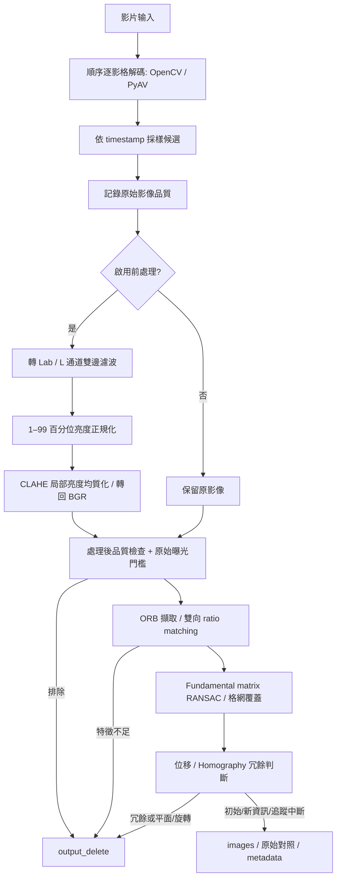

# 車體環繞影片 Keyframe Extraction

從環繞車體拍攝影片中，挑選可供後續 3D 重建使用的代表影格。此 Python baseline 先做降噪、亮度正規化與局部亮度均質化，再檢查品質、配對特徵及判斷幾何冗餘；輸出照片和可追溯的 metadata。

目前提供 **reconstruction-aware 的幾何啟發式選取**，尚未執行 SfM / MVS、重建車體、驗證 360°。

## 1. 環境與安裝

- Python 3.10 以上。
- 必要依賴：NumPy、OpenCV。
- 選用依賴：PyAV；不需另行安裝 FFmpeg CLI 才能使用 PyAV。
- 以下命令使用 Windows PowerShell，VS Code 內建終端機也適用。

在專案根目錄（含 `pyproject.toml`）執行：

```powershell
cd 'C:\Users\USER\OneDrive\Desktop\NTU\4_Senior\hackthon\ai-vehicle-inspection\vehicle_keyframes'
py -m venv .venv
.\.venv\Scripts\python.exe -m pip install -e .
.\.venv\Scripts\python.exe -m vehicle_keyframes.cli --help
```

## 2. 執行方式

### 預設執行：前處理開啟

影片位於專案上一層時：

```powershell
.\.venv\Scripts\python.exe -m vehicle_keyframes.cli '..\0001-1000.mp4' --output output\car01
```

也可使用影片絕對路徑。`--output` 必須指定不存在的新資料夾；再次執行請改成 `output\car02`。相對輸入／輸出路徑以終端機目前目錄為基準，不以 `.py` 檔案位置為基準。

### 參數調整方式

1. 直接到 config.py 進行調整

2. 在 terminal 執行時進行調整，範例如下:
    ```powershell 
    .\.venv\Scripts\python.exe -m vehicle_keyframes.cli '..\0001-1000.mp4' --output output\enhanced --denoise-sigma 15 --clahe-clip 2 --clahe-grid 8
    ```

## 3. 架構與處理順序



### 解碼與候選採樣

`decode()` 順序讀取每張影格，以 generator 逐張傳遞，不將完整影片載入記憶體。`candidates()` 保留第一張，之後在 timestamp 到達「上一候選時間 + sample_seconds」時取下一張。

目前程式預設 `sample_seconds = 0.1`。對常見 30 / 60 FPS 影片，通常每張影格都會進入分析。實際數量依 timestamp 決定；對更高 FPS 或不規則時間間隔，不保證全部保留。

| 間隔 | 理想候選速率上限 | 說明 |
|---|---:|---|
| 0.3 秒 | 約 3.3 張/秒 | 較低分析成本 |
| 0.1 秒 | 約 10 張/秒 | 中等密度 |
| 0.05 秒 | 約 20 張/秒 | 實際值受 FPS 離散間隔影響 |

### 降噪與亮度處理

`preprocess.enhance()` 在原解析度處理影像：

1. BGR 轉 Lab，分離 L 亮度與 a/b 色彩通道。
2. 對 L 使用雙邊濾波：固定 neighborhood diameter 5、spatial sigma 3，range sigma 由 `denoise_sigma` 控制。0 表示略過降噪。
3. 計算 L 的第 1、99 百分位。兩者差距至少 10 時，把觀測亮度範圍映射到 16–235，超出部分裁切至 0–255；差距不足則略過正規化。
4. 對 L 做 CLAHE，限制局部對比增強，再與原 a/b 合併轉回 BGR。

此處理可改善亮度不均與仍有細節的偏亮／偏暗影像，不重建，也不恢復已飽和成純白的細節。

### 品質過濾

分析影像縮至最大寬度 `analysis_width`（預設 960），保持比例，不放大小影像。原始與處理後影像皆以相同分析大小／ROI 評估：

- `blur_score`：Laplacian variance，越高通常表示更多清楚細節。
- `clipped_fraction`：灰階 ≤5 或 ≥250 的像素比例，合計暗／亮 clipping。
- `mean_luma`：平均灰階亮度，僅記錄，不參與門檻判定。

必須同時滿足：處理後 blur_score ≥ blur_min、處理後 clipped_fraction ≤ clipped_max、原始 clipped_fraction ≤ clipped_max。原始 blur_score 會記錄，但不直接作為接受條件。

原始曝光門檻避免處理後變暗的純白區域被視為恢復成功。

### 特徵配對與幾何決策

ORB 產生特徵座標與二進位描述子；Hamming KNN matching 找兩個鄰近描述子，以 ratio test 排除模糊配對，再保留雙向一致的配對。

每個候選比較的 reference 是**上一張選取的 keyframe**。Fundamental matrix RANSAC 檢查幾何一致性；inlier 數、比例和兩張影像的 4×4 格網覆蓋用來判定配對是否可信。

`motion` 為 inlier 的中位像素位移 / 分析影像對角線。`homography_fraction` 為同時符合 homography 的 fundamental inliers 比例。判斷順序：

| reason | 判斷／用途 | 結果 |
|---|---|---|
| `quality_rejected` | 品質或原始 clipping 不合格 | 排除 |
| `insufficient_features` | ORB 特徵數低於 min_inliers | 排除 |
| `initial` | 第一張通過品質且特徵足夠的候選 | 選取 |
| `tracking_lost` | 配對不足、幾何不可信或分析尺寸改變 | 選取並開始新 segment |
| `redundant` | 可信配對，但 motion 太小 | 排除 |
| `planar_or_rotation` | 位移足夠，但 homography_fraction 過高 | 排除 |
| `geometry_novel` | 可信配對且通過位移／homography 檢查 | 選取 |

## 4. 完整參數

以 `--help` 查看 CLI。表格預設值對應目前 `config.py`。

| 參數 | 預設 | 意義 |
|---|---:|---|
| `video` | 必填 | 來源影片路徑 |
| `--output` | 必填 | 新輸出資料夾 |
| `--backend` | opencv | opencv / pyav |
| `--sample-seconds` | 0.1 | 正數候選時間間隔（秒） |
| `--analysis-width` | 960 | 最大分析寬度，至少 32 |
| `--preprocess` / `--no-preprocess` | 啟用 | 開啟／關閉整個前處理 |
| `--denoise-sigma` | 15 | L 雙邊濾波 range sigma，≥0；0 關閉降噪 |
| `--clahe-clip` | 2 | CLAHE clip limit，>0 |
| `--clahe-grid` | 8 | 每軸 tile 數（8×8），整數 ≥1 |
| `--blur-min` | 60 | 處理後最低 Laplacian variance，≥0 |
| `--clipped-max` | 0.35 | 原始與處理後最大 clipping 比例，0–1 |
| `--features` | 3000 | ORB 最大特徵數，至少 8 |
| `--ratio` | 0.75 | KNN ratio threshold，0 < ratio < 1 |
| `--min-inliers` | 30 | 最低幾何 inlier 數，至少 8；亦用作 ORB 初步特徵數門檻 |
| `--min-inlier-ratio` | 0.35 | inliers / mutual matches 最低比例，0–1 |
| `--min-grid-coverage` | 0.25 | 兩張影像最低格網占用比例，0–1 |
| `--min-motion` | 0.025 | 最低中位位移 / 分析影像對角線，≥0 |
| `--homography-ratio` | 0.90 | 達到此比例時判為 planar_or_rotation，0–1 |
| `--ransac-px` | 2 | 分析影像上的 RANSAC 像素誤差容忍，>0 |
| `--roi X Y W H` | 全畫面 | 位於 [0,1] 範圍內的正規化矩形 |


## 5. 輸出格式

```text
output/car01/
├── images/
│   └── frame_00000000.jpg
├── images_original/
│   └── frame_00000000.jpg
├── output_delete/
│   └── frame_00000042_redundant.jpg
└── metadata.json
```

- `images/`：選取的處理後影像；關閉前處理時為原影像。
- `images_original/`：前處理啟用時，同一組 keyframes 的未前處理對照。
- `output_delete/`：被排除候選的處理後影像，檔名附排除原因；關閉前處理時為原影像。不儲存被排除候選的原始對照。
- 所有照片保持原解析度，以 JPEG quality 95 重新編碼；images_original 不是影片資料的無損保存。
- 輸出資料夾即使沒有影像也可能存在；關閉前處理時不建立 images_original。

### metadata.json

頂層包含：

| 欄位 | 意義 |
|---|---|
| `schema_version` | 目前 1 |
| `video` | 來源影片絕對路徑 |
| `config` | 本次完整設定 |
| `candidates` | 所有被採樣並進入分析的候選 |
| `keyframes` | 選取候選的記錄副本 |
| `warnings` | 追蹤中斷／無影格等警告 |
| `status` | running / complete / no_keyframes / failed |
| `coverage_verified` | 正常完成分析後設為 false，尚未驗證全域覆蓋 |
| `error` | 處理失敗時的錯誤文字（若有） |

每筆候選包含 frame_index（零起算）、timestamp_seconds（解碼時間軸）、original_quality、quality、preprocessed、selected、segment 和 reason。

- original_quality 為原始影像分數；quality 為送入選取流程的影像分數。
- 有執行幾何比較時，geometry 包含 matches、inliers、inlier_ratio、grid_coverage、motion 和 homography_fraction；早期失敗時未計算的指標保留初始 0。
- 選取項目含 image；前處理啟用時另含 original_image。
- 排除項目含 rejected_image。
- 圖片路徑皆相對於該次輸出目錄，不是來源影片目錄。

`complete` 只代表至少有一張 keyframe 且流程完成，不代表車體覆蓋完整。處理迴圈中的例外會寫入部分 metadata；輸入檢查或建立輸出目錄之前／期間的錯誤不保證留下 metadata。

CLI 成功回傳 0；被 CLI 捕捉的輸入／檔案／依賴錯誤回傳 1；沒有可用 keyframe 回傳 2。其他未捕捉例外可能顯示 traceback。

## 6. 程式結構

```text
vehicle_keyframes/
├── pyproject.toml
├── README.md
├── .gitignore
├── src/vehicle_keyframes/
│   ├── __init__.py
│   ├── config.py
│   ├── cli.py
│   ├── video.py
│   ├── preprocess.py
│   ├── quality.py
│   ├── geometry.py
│   ├── pipeline.py
│   └── extensions.py
└── tests/
    ├── test_baseline.py
    └── test_preprocess.py
```

| 模組 | 職責 |
|---|---|
| config.py | dataclass 設定與預設值 |
| cli.py | 讀取 CLI、檢查參數、呼叫 pipeline |
| video.py | 逐影格解碼與 timestamp 候選採樣 |
| preprocess.py | Lab L 降噪、百分位正規化、CLAHE |
| quality.py | 分析縮圖、ROI、blur／exposure 分數 |
| geometry.py | ORB、雙向配對、RANSAC、冗餘分類 |
| pipeline.py | 串接流程、更新 reference、存檔與 metadata |
| extensions.py | 未實作的 SfM／coverage protocols |

## 7. 驗證與故障排除

執行測試：

```powershell
.\.venv\Scripts\python.exe -m unittest discover -s tests -v
```

現有測試涵蓋品質拒絕、幾何位移／平面／靜止分類、追蹤中斷、JPEG／JSON 輸出、防覆寫、原始對照、前處理關閉、偏亮低對比改善、平坦區雜訊降低與原始純白過曝拒絕。合成測試不等於真實車輛 SfM 精度驗證。

| 問題 | 檢查方式 |
|---|---|
| No module named vehicle_keyframes | 回到含 pyproject.toml 的根目錄，使用同一個 `.venv` Python 重新執行 `-m pip install -e .` |
| Python 路徑找不到 | 正確相對路徑是 `.\.venv\Scripts\python.exe`，不是 venv\Script |
| 輸出資料夾已存在 | 使用新的 --output；程式不覆寫舊結果 |
| 沒有 keyframes | 看 metadata reason 與 original_quality／quality；檢查 ROI、影片和閾值 |
| 被判為過曝但照片看起來已變暗 | 原始 clipping 仍會過濾，前處理不能補回飽和細節 |
| 選取太多 | 檢查 tracking_lost 是否過多，再調整 motion 與採樣；不要只硬切張數 |
| 選取太少 | 檢查 quality_rejected、insufficient_features、planar_or_rotation 的比例，對照 output_delete |
| 速度慢／磁碟用量高 | 增大 sample-seconds；目前預設 0.01 很密集，前處理為原解析度且排除候選也寫 JPEG |
| 不支援影片格式／timestamp | 嘗試 PyAV backend，或先用外部 FFmpeg 轉檔 |
