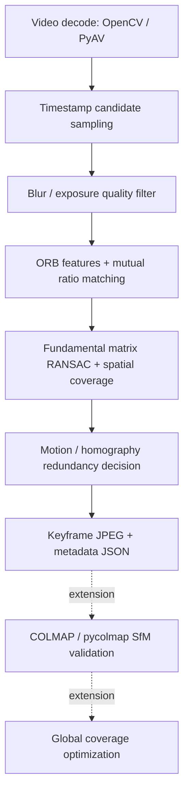

# 車體影片 Reconstruction-aware Keyframe Extraction

未選取的候選影格會以原解析度 JPEG 存入每次輸出資料夾的 `output_delete/`。檔名含原始 frame index 與排除原因，例如 `frame_00000042_redundant.jpg`；`metadata.json` 的候選項目另記錄 `rejected_image` 相對路徑。涵蓋 `quality_rejected`、`insufficient_features`、`redundant` 與 `planar_or_rotation`。時間採樣階段未送入分析的影格不在此資料夾；若要分析每張影格，將 `--sample-seconds` 設為小於影片每張影格間隔的正數。此功能額外增加 JPEG 寫入時間及磁碟用量。

Python baseline：從環繞車體影片挑選清楚、可配對且具有幾何變化的影格，輸出原解析度 JPEG 與可追溯 JSON。這是幾何啟發式選擇器，尚未執行 SfM，也不保證 20 張即可建模或完整 360° 覆蓋。

## 安裝與執行（Windows PowerShell）

安裝 Python 3.10 以上並確認 `py` 可執行。進入本專案：

```powershell
cd 'C:\Users\USER\OneDrive\Desktop\NTU\4_Senior\hackthon\vehicle-keyframes'
py -m venv .venv
.\.venv\Scripts\python.exe -m pip install -e .
.\.venv\Scripts\python.exe -m vehicle_keyframes.cli 'C:\videos\car.mp4' --output outputs\car01
```

`--output` 必須是不存在的新資料夾，避免覆寫先前結果。不必啟用虛擬環境；也可使用安裝後的 `vehicle-keyframes` 命令。

需要較可靠的影片 presentation timestamps，或處理 variable frame rate 時，使用 PyAV：

```powershell
.\.venv\Scripts\python.exe -m pip install -e '.[av]'
.\.venv\Scripts\python.exe -m vehicle_keyframes.cli 'C:\videos\car.mp4' --backend pyav --sample-seconds 0.2 --roi 0.1 0.1 0.8 0.8 --output outputs\car02
```

OpenCV 的可解碼格式取決於安裝的 backend。介面接受一般影片檔；需要前處理可先由 FFmpeg 轉成 H.264 MP4，例如 `ffmpeg -i input.mov -c:v libx264 -crf 18 -an car.mp4`。轉檔會改變壓縮品質；baseline 不自動呼叫外部程式。

## 架構



```text
vehicle-keyframes/
├── pyproject.toml
├── README.md
├── .gitignore
├── src/vehicle_keyframes/
│   ├── __init__.py
│   ├── config.py       # defaults
│   ├── video.py        # decode + timestamp sampling
│   ├── quality.py      # blur / exposure / ROI
│   ├── geometry.py     # ORB + matching + geometry
│   ├── pipeline.py     # selection + output + extension hooks
│   ├── extensions.py   # SfMValidator / CoverageOptimizer protocols
│   └── cli.py
└── tests/test_baseline.py
```

## 技術與決策

1. 依時間間隔挑 candidate，但仍順序解碼所有影格，因此採樣主要減少分析成本，並未直接減少解碼成本。PyAV 使用 frame timestamp；OpenCV 使用 POS_MSEC，無效時依 FPS 推估。
2. 將分析影像縮至最大寬度 960；Laplacian variance 衡量清晰度，接近黑/白的像素比例衡量曝光 clipping。這些分數受解析度、紋理和光線影響，需依資料調整。
3. ORB 產生局部二進位描述子；Hamming KNN、ratio test 與雙向一致配對降低錯配。
4. 對「上一張選取影格」估計 fundamental matrix，以 RANSAC inlier 數、比例及兩張影像的 4×4 格網覆蓋檢查幾何配對。
5. 正規化的中位像素位移過小 → `redundant`。大部分 fundamental inliers 也符合 homography → `planar_or_rotation`，暫不選取。其他可信配對 → `geometry_novel`。
6. 配對不足 → `tracking_lost`：保留清楚且具足夠特徵的候選作為新 segment 起點，metadata 警告 overlap 未確認。這是恢復策略，不能當作幾何新資訊的證明。

像素位移不是三角化視差；homography 也不能完整區分純旋轉、平面或低基線。ROI 為固定矩形，不是車體 segmentation；預設全畫面可能受背景主導。反光漆面、玻璃、低紋理、移動物體會造成錯配或缺少特徵。最後一張不強制保留，不能以輸出数量判定拍攝完成。

## 參數

所有參數可用 `--help` 查看。單位皆基於縮小後的分析影像；JPEG 保持原解析度。

| 參數 | 預設 | 用途 |
|---|---:|---|
| `--backend` | opencv | opencv / pyav |
| `--sample-seconds` | 0.3 | 候選時間間隔（秒） |
| `--analysis-width` | 960 | 最大分析寬度 |
| `--blur-min` | 60 | 最低 Laplacian variance |
| `--clipped-max` | 0.35 | 灰階 ≤5 或 ≥250 的最大比例 |
| `--features` | 3000 | ORB 最大特徵數 |
| `--ratio` | 0.75 | KNN ratio threshold |
| `--min-inliers` | 30 | 最低幾何 inlier 數 |
| `--min-inlier-ratio` | 0.35 | 最低 inlier / mutual matches |
| `--min-grid-coverage` | 0.25 | 兩張影像最低格網占用比例 |
| `--min-motion` | 0.025 | 最低中位位移 / 影像對角線 |
| `--homography-ratio` | 0.90 | homography 支持的 F inliers 比例上限 |
| `--ransac-px` | 2 | RANSAC 像素誤差閾值 |
| `--roi X Y W H` | 全畫面 | 正規化車體區域，範圍 0–1 |

太少影格：檢查候選拒絕原因，必要時降低 blur/min-motion 或提高 homography-ratio；太多影格：檢查 tracking_lost，比單純提高閾值更重要。追蹤中斷可先縮短 sample-seconds，改善影格間 overlap。品質通過但 ORB 太少時仍會拒絕。

## 輸出格式

```text
outputs/car01/
├── images/frame_00000000.jpg
├── images/frame_00000042.jpg
└── metadata.json
```

JSON 包含 `schema_version`、來源絕對路徑、完整參數、`status`、`coverage_verified: false`、`warnings`、所有 `candidates` 和選取的 `keyframes`。每筆含 `frame_index`（零起算）、`timestamp_seconds`（原解碼時間軸）、quality 分數、`reason`、`selected`、`segment`；已選取項目另含相對 `image` 路徑。可配對項目包含 matches、inliers、inlier_ratio、grid_coverage、motion、homography_fraction。

失敗時儲存部分 metadata 並標記 `failed`，輸出資料夾保留供檢查。CLI exit code：0 成功、1 輸入/執行錯誤、2 沒有可用 keyframe。不提供強制張數截斷，避免破壞配對鏈。

## 驗證

```powershell
.\.venv\Scripts\python.exe -m unittest discover -s tests -v
```

測試用合成影片驗證靜止冗餘、曝光/模糊拒絕、幾何配對、追蹤斷裂、輸出與防覆寫；不代表真實車輛的重建精度。需用實拍資料驗證註冊率、軌跡完整性和模型品質。

## SfM / coverage 介面與 roadmap

`pipeline.run(video, output, config, validator=..., optimizer=...)` 接受 `extensions.py` 定義的 protocols。Validator 的 `validate(images_dir, metadata)` 回傳可 JSON 序列化的 SfM 結果；Optimizer 的 `optimize(metadata, sfm_result)` 回傳原始 frame indices。baseline 僅記錄 `optimized_indices`，不刪除影像、不重寫選取結果；尚無內建 COLMAP adapter。

1. 實拍 benchmark：比較固定時間取樣與本方法的 keyframe 數、耗時、SfM 註冊率、reprojection error 和 track length。
2. 車體 detection / segmentation、逐影格 mask，降低背景與反光影響；相機校正與畸變處理。
3. COLMAP / pycolmap adapter：sequential matching、loop closure、camera pose、triangulation angle 與 registered-image graph。
4. 全域最佳化：由車體中心及 camera pose 估計環繞角度，加入可見表面、重疊和連通限制，以集合覆蓋或圖最佳化縮減影格。
5. 目標約 20 張作為 soft budget；無法保持品質時增加張數，並回報缺失視角與補拍建議。

技術參考：[OpenCV 幾何估計](https://docs.opencv.org/4.4.0/d9/d0c/group__calib3d.html)、[COLMAP 拍攝與重建教學](https://colmap.github.io/tutorial.html)。COLMAP 建議高視角重疊；單靠影格差異不足以保證重建。
